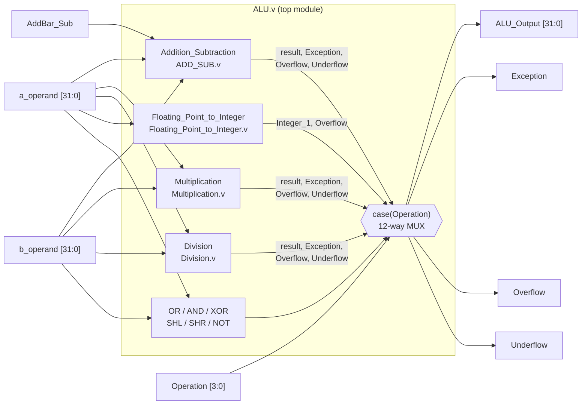
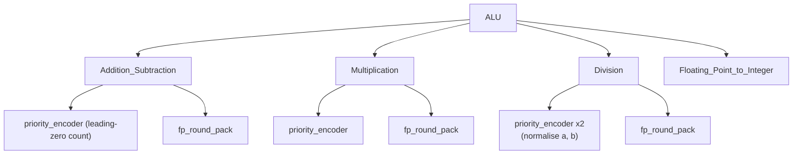
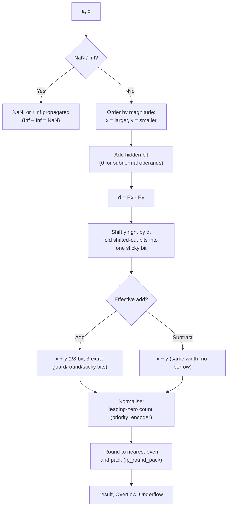
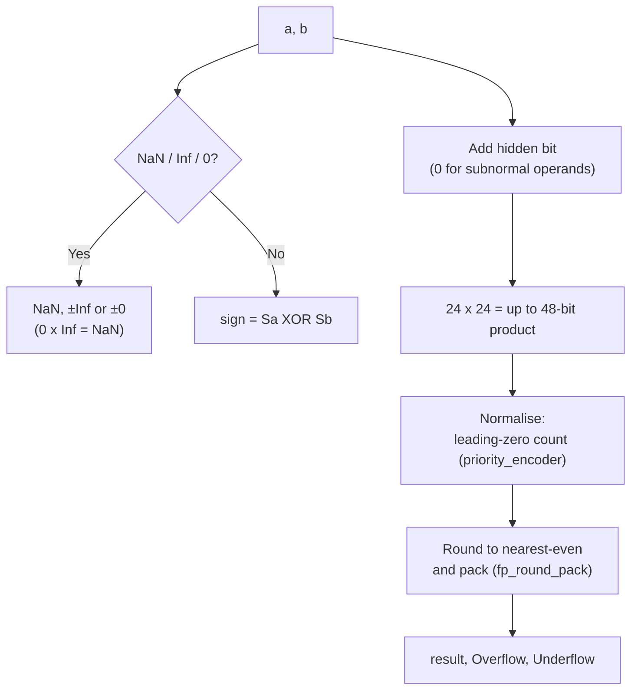
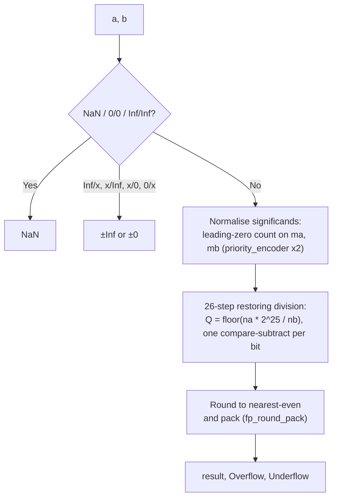
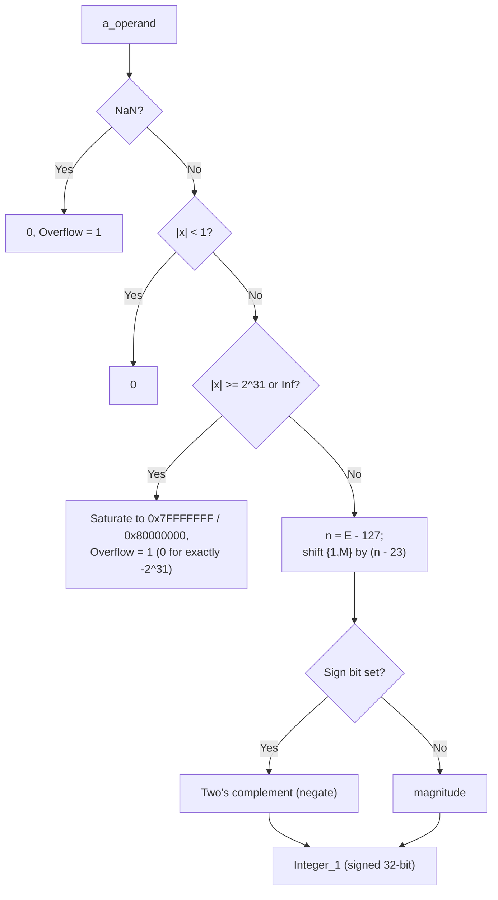

# 32-bit Floating Point ALU (IEEE 754) – Verilog

A single-precision (float32) floating point ALU written in Verilog: add, subtract, multiply, divide, float-to-integer conversion, and bitwise/shift operations. The whole design is **combinational** (no clock, reset or FSM). It is **bit-exact against IEEE 754** (round-to-nearest-even, full subnormal/Inf/NaN handling) — see [Simulation and verification](#6-simulation-and-verification).

The datapath started from *Design of 32 Bit Floating Point ALU Based on Standard IEEE-754 in Verilog* (S. S. Burada, Dayalbagh Educational Institute, 2019) and was rewritten; see [Known issues and fixes](#7-known-issues-and-fixes) for what changed and why.

## Contents

| Path | Description |
| --- | --- |
| `ALU.v`, `ADD_SUB.v`, `Multiplication.v`, `Division.v`, `priority_encoder.v`, `Floating_Point_to_Integer.v` | ALU RTL |
| `tb_ALU.v`, `gentb.py` | Self-checking testbench (8,734 cases, bit-exact) and the script that generates it |
| `docs/index.html`, `docs/alu_model.js` | Web demo: enter operands, run an operation, compare with the exact float32 result |
| `alu_server.py`, `tb_run.v`, `run_demo.bat` | Local server that runs the demo page's cases through the real RTL in **Vivado xsim** (Icarus Verilog fallback) |

## 1. IEEE 754 single precision format

```
 31   30        23 22                      0
+---+------------+-------------------------+
| S |  E (8 bit) |       M (23 bit)        |
+---+------------+-------------------------+
x = (-1)^S * 1.M * 2^(E-127)      (1 <= E <= 254)
E = 0   : zero / subnormal        E = 255 : Inf (M = 0) / NaN (M != 0)
```

All four arithmetic units (add/sub, multiply, divide) share one rounding and packing block, `fp_round_pack` in `priority_encoder.v`: round-to-nearest-even with full guard/round/sticky bits, gradual underflow to subnormals, and overflow to ±Inf.

## 2. Top-level block diagram



### Opcode table

| Operation | Function | Notes |
| --- | --- | --- |
| 0 | Add / Subtract | `AddBar_Sub` = 0 adds, = 1 subtracts |
| 1 | Multiply | |
| 2 | Divide | |
| 3 | Subtract | Forces subtract regardless of `AddBar_Sub` |
| 4 / 5 / 6 | OR / AND / XOR | Bitwise on all 32 bits |
| 7 / 8 | Shift left / right by 1 | Logical shift |
| 9 | Float → signed 32-bit integer | Truncate toward zero, saturating |
| 10 | Add | Forces add regardless of `AddBar_Sub` |
| 11 | NOT | |
| 12–15 | – | Output 0 |

Flags: **Exception** = an operand of a float op is Inf or NaN; **Overflow** = a float result rounds to ±Inf, or (opcode 9) the integer result saturated or the input was Inf/NaN; **Underflow** = a float result is subnormal and inexact.

## 3. Module hierarchy



`priority_encoder` (leading-zero counter) and `fp_round_pack` (round-to-nearest-even + pack) live together in `priority_encoder.v` and are instantiated by all three arithmetic units, so there is one rounding implementation to get right instead of three.

## 4. Data path of each algorithm

### 4.1 Add / Subtract (`ADD_SUB.v`)



### 4.2 Multiply (`Multiplication.v`)



### 4.3 Divide (`Division.v`)



Restoring division produces the exact quotient bit by bit (26 compare-subtract steps, no multiplier), so the result is bit-exact after rounding — see [Known issues](#7-known-issues-and-fixes) for why this replaced the original Newton-Raphson datapath.

### 4.4 Float → integer (`Floating_Point_to_Integer.v`)



## 5. Web demo

### Quick start (JS model only)

Open `docs/index.html` in a browser (double-click, no server needed). Enter operands as decimal numbers, `inf`, `nan` or hex bit patterns, choose an operation, and the page shows:

- the ALU output (hex, bit fields, decimal) and the Exception / Overflow / Underflow flags;
- the float32 reference (round-to-nearest) and the exact 64-bit value;
- absolute error, relative error, error in ULP and a verdict (bit-exact / within 1 ULP / mismatch);
- a preset test suite and a random accuracy test per operation.

In this mode the page runs `docs/alu_model.js`, a bit-accurate JavaScript port of the RTL (checked against 410,704 Icarus Verilog simulation vectors — outputs and flags, including subnormals, Inf and NaN — with 0 mismatches).

### Run the real RTL in Vivado

Start the local server (Python 3, standard library only):

```
python alu_server.py --open        (or double-click run_demo.bat)
```

then use the page at `http://127.0.0.1:8000/`. The **Engine** menu now offers *Vivado xsim (real RTL)*; every **Run** click, preset suite or random test is sent to the server, which writes the cases to a vector file and runs `tb_run.v` with `xvlog`, `xelab` and `xsim` (the elaborated snapshot is cached in `sim_build/` and rebuilt only when an RTL file changes).

- Vivado is found automatically from `PATH`, `XILINX_VIVADO`/`VIVADO_BIN`, or the usual `C:\Xilinx\Vivado\<version>\bin` folders. Otherwise pass it explicitly: `python alu_server.py --vivado-bin "C:\Xilinx\Vivado\2023.2\bin"`.
- If Vivado is not installed but Icarus Verilog is, the server uses that instead (`--sim vivado|iverilog|auto`).
- The server only listens on `127.0.0.1` and accepts opcodes and 32-bit operands only; it never takes file paths from the page.

To publish the JS-only page with GitHub Pages: *Settings → Pages → Deploy from a branch → `main` / `/docs`*. The Vivado engine needs the local server and is not available there.

## 6. Simulation and verification

- Tools: Icarus Verilog, ModelSim or Vivado Simulator.
- Self-checking testbench: `tb_ALU.v` (top = `tb_ALU`). It prints `TONG: N case, DUNG=…, SAI=…` (total / pass / fail) and lists each failing case with its expected value. Currently **8,734 / 8,734 pass** (bit-exact match, no tolerance).
- `gentb.py` regenerates the testbench; expected values come from Python's own IEEE 754 binary32 arithmetic (`struct` pack/unpack through `'f'`), covering special values (0, ±1, Inf, NaN, subnormals, …), 1,500 random normal/subnormal pairs per arithmetic op, float→integer edge cases (saturation, exactly ±2³¹) and the bitwise/shift ops.
- Independently, a 410,704-case Icarus Verilog sweep (random + edge-case operands, including subnormals and Inf/NaN) was checked against a second, separately written Python reference: **100.0000% bit-exact on every operation, 0 flag mismatches.**

| Operation | Bit-exact |
| --- | --- |
| Add / Subtract | 100% |
| Multiply | 100% |
| Divide | 100% |
| Float → Integer | 100% |

## 7. Known issues and fixes

The arithmetic units (`ADD_SUB.v`, `Multiplication.v`, `Division.v`, `Floating_Point_to_Integer.v`, `priority_encoder.v`) were rewritten from the original linked at the top of this file. Reasons:

1. **`Multiplication.v` did not compile** — missing `assign result` and `endmodule`, four signals assigned twice.
2. **No rounding** — the original only truncated (add/sub, divide) or rounded on guard-bit-and-sticky without ties-to-even (multiply), so results could be up to 1 ULP off; the rewrite rounds to nearest-even with full guard/round/sticky in every unit.
3. **`ADD_SUB.v`: narrow two's complement** — the original's complement of the shifted significand was only 24 bits, so an exponent difference ≥ 24 lost the carry (e.g. `3e38 − 1.0` returned `1.7e38`); it is now 25+ bits and exact.
4. **`ADD_SUB.v`: `x − x` returned `2^-24`** instead of `+0`, because the all-zero case fell through the original's leading-zero table into its `default` branch.
5. **`Multiplication.v`: wrong `zero` flag** — it was derived from the *rounded result's* mantissa, so every power of two (`1.0 × 1.0`, `2.0 × 0.5`, …) was reported as zero; the rewrite only checks the operands and is no longer needed, since `fp_round_pack` produces the correct zero/subnormal/normal result directly.
6. **`Division.v`: wrong Newton-Raphson seed** (`−37/17` instead of `−32/17`) made ~46% of cases with a mantissa ≥ 1.875 wrong by hundreds of ULP, and even corrected the method still lost 2–4 ULP per division because every adder/multiplier inside the 3 iterations truncated. **Division.v now uses an exact restoring divider** (26 compare-subtract steps on the significands, no multiplier) instead of Newton-Raphson, and is bit-exact.
7. **Inf/NaN inputs returned 0** on add, subtract and multiply; now NaN → qNaN (`0x7FC00000`), `Inf − Inf` → NaN, `0 × Inf` → NaN, and finite ± Inf propagate correctly, matching IEEE 754.
8. **Subnormal numbers were not supported** — every unit now treats exponent 0 as hidden-bit-0 / exponent 1 on input, and `fp_round_pack` produces gradual underflow (a subnormal result) instead of flushing to zero or garbage.
9. **`ALU.v`: opcodes 3 and 10 did not force `AddBar_Sub`** — subtract (3) and add (10) simply followed the `AddBar_Sub` pin like opcode 0; they now force it.
10. **`Floating_Point_to_Integer.v` only cleared fraction bits and returned a float**, not an integer, and for `|x| < 1` it kept the exponent (`trunc(0.75)` returned `0.5`). It now returns a real signed 32-bit integer, truncated toward zero and saturating on overflow, Inf or NaN (with the `Overflow` flag set).
11. **Overflow/Underflow were reported only for multiply**; add, subtract, divide and float→integer now report them too.
12. **README.md described an unrelated AES-256 project.**

No functional gaps remain in the arithmetic (see the verification numbers above). The main thing a future change could improve is **latency/area**: this is a single combinational block, and `Division.v`'s 26-step restoring divider is the longest path in the design (no multiplier, but a long carry chain). For an FPGA target running at high frequency, pipelining the divider (or the whole ALU) across a few clock cycles would be the natural next step — that is also where real sequential logic (registers, a small FSM) would enter this otherwise purely combinational design.
