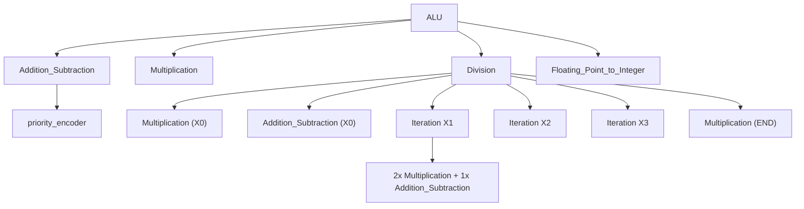
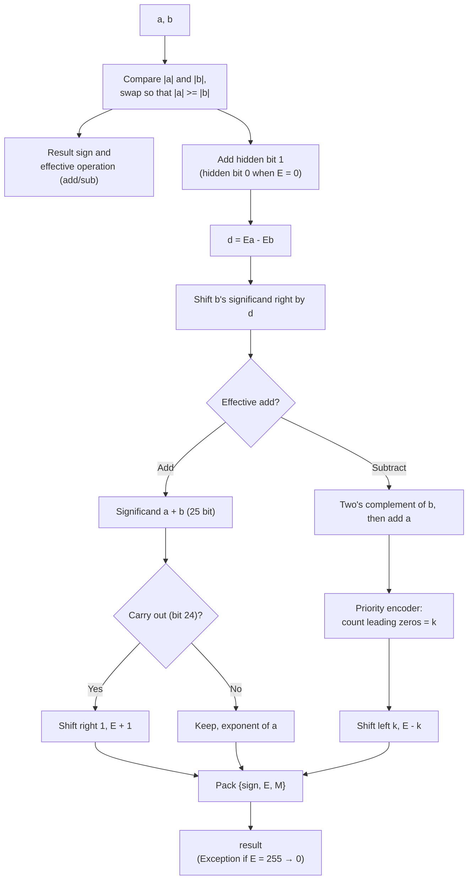
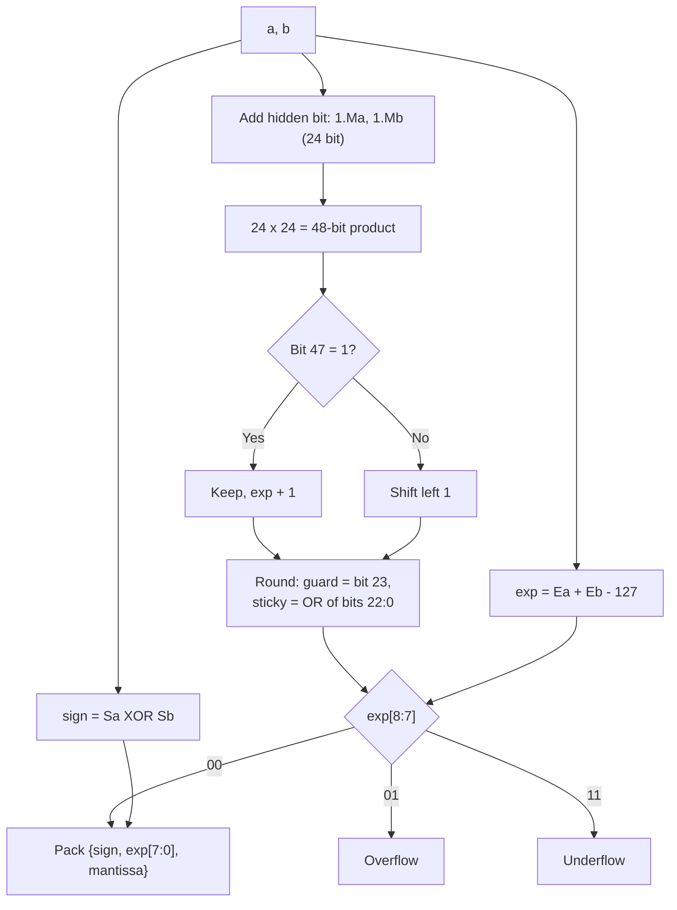
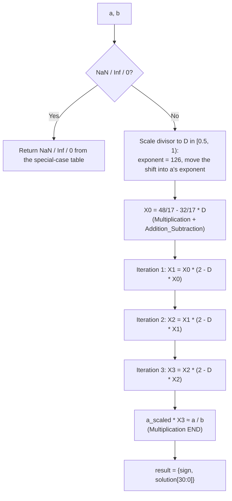
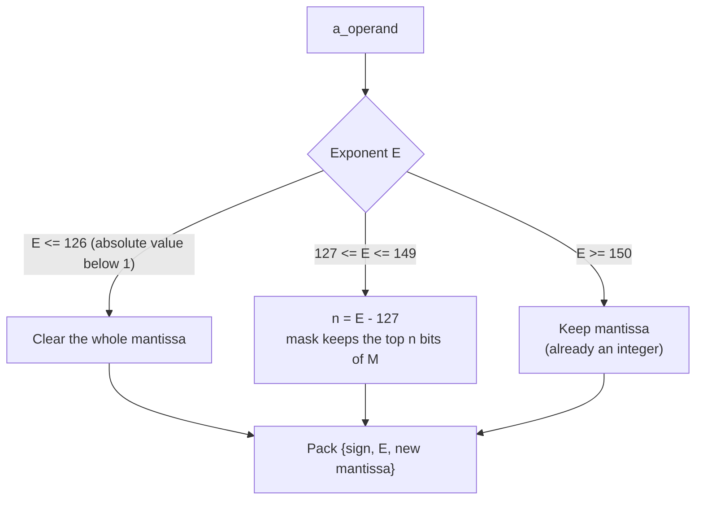

# 32-bit Floating Point ALU (IEEE 754) – Verilog

A single-precision (float32) floating point ALU written in Verilog: add, subtract, multiply, divide (Newton-Raphson), float-to-integer-part conversion, and bitwise/shift operations. The whole design is **combinational** (no clock, reset or FSM).

The add/subtract/multiply/divide core is based on *Design of 32 Bit Floating Point ALU Based on Standard IEEE-754 in Verilog* (S. S. Burada, Dayalbagh Educational Institute, 2019).

## Contents

| Path | Description |
| --- | --- |
| `*.v` | ALU RTL as originally written |
| `rtl_fixed/` | Corrected RTL (see [Known issues](#7-known-issues-and-fixes)) |
| `tb_ALU.v`, `gentb.py` | Self-checking testbench (4,109 cases) and the script that generates it |
| `docs/index.html`, `docs/alu_model.js` | Web demo: enter operands, run an operation, compare with the exact float32 result |

## 1. IEEE 754 single precision format

```
 31   30        23 22                      0
+---+------------+-------------------------+
| S |  E (8 bit) |       M (23 bit)        |
+---+------------+-------------------------+
x = (-1)^S * 1.M * 2^(E-127)      (1 <= E <= 254)
E = 0   : zero / subnormal        E = 255 : Inf (M = 0) / NaN (M != 0)
```

## 2. Top-level block diagram


### Opcode table

| Operation | Function | Notes |
| --- | --- | --- |
| 0 | Add / Subtract | `AddBar_Sub` = 0 adds, = 1 subtracts |
| 1 | Multiply | Drives Overflow/Underflow flags |
| 2 | Divide | Newton-Raphson |
| 3 | Subtract | Shares the Addition_Subtraction hardware |
| 4 / 5 / 6 | OR / AND / XOR | Bitwise on all 32 bits |
| 7 / 8 | Shift left / right by 1 | Logical shift |
| 9 | Float → integer part (trunc) | Drops the fraction, keeps float format |
| 10 | Add | Shares the Addition_Subtraction hardware |
| 11 | NOT | |
| 12–15 | – | Output 0 |

## 3. Module hierarchy



## 4. Data path of each algorithm

### 4.1 Add / Subtract (`ADD_SUB.v`, `priority_encoder.v`)



### 4.2 Multiply (`Multiplication.v`)



### 4.3 Divide – Newton-Raphson (`Division.v`, `Iteration.v`)



Each `Iteration` is two float multiplications and one float subtraction: `X(n+1) = X(n) * (2 - D * X(n))`. The error squares at every step (quadratic convergence).

### 4.4 Float → integer part (`Floating_Point_to_Integer.v`)



## 5. Web demo

Open `docs/index.html` in a browser (double-click, no server needed). Enter operands as decimal numbers, `inf`, `nan` or hex bit patterns, choose an operation, and the page shows:

- the ALU output (hex, bit fields, decimal) and the Exception / Overflow / Underflow flags;
- the float32 reference (round-to-nearest) and the exact 64-bit value;
- absolute error, relative error, error in ULP and a verdict (bit-exact / within 1 ULP / small error / mismatch);
- a preset test suite and a 5,000-sample random accuracy test per operation.

The page runs `docs/alu_model.js`, a bit-accurate JavaScript port of the corrected RTL. It was checked against 182,304 Icarus Verilog simulation vectors (outputs and flags) with 0 mismatches. To publish it with GitHub Pages: *Settings → Pages → Deploy from a branch → `main` / `/docs`*.

## 6. Simulation and verification

- Tools: Icarus Verilog, ModelSim or Vivado Simulator.
- Self-checking testbench: `tb_ALU.v` (top = `tb_ALU`). It prints `TONG: N case, DUNG=…, SAI=…` (total / pass / fail) and lists each failing case. Add `rtl_fixed/*.v` and `tb_ALU.v` to the simulation sources.
- `gentb.py` regenerates the testbench; expected values come from Python float32 (round-to-nearest). Change the output path inside the script if you run it on your machine.

Measured accuracy of the corrected RTL against IEEE 754 float32 (normal inputs and results, 20,000 random pairs plus edge cases):

| Operation | Bit-exact | Within 1 ULP | Max ULP |
| --- | --- | --- | --- |
| Add | 69.6% | 99.3% | 8 |
| Subtract | 69.7% | 99.4% | 16 |
| Multiply | 100% | 100% | 0 |
| Divide | 28.1% | 68.2% | 4 |

## 7. Known issues and fixes

Fixes already in `rtl_fixed/`:

1. `Multiplication.v`: missing `assign result` and `endmodule`, duplicated assignments (the original does not compile).
2. `Multiplication.v`: the `zero` flag was derived from the result mantissa, so every power of two (e.g. 1.0 × 1.0) returned 0; it now tests the operands.
3. `Division.v`: Newton-Raphson seed constant changed from −37/17 (`C00B4B4B`) to −32/17 (`BFF0F0F1`).
4. `Multiplication.v`: round-to-nearest-even with the rounding carry propagated into the exponent.
5. `ADD_SUB.v`: 25-bit two's complement (exponent difference ≥ 24 no longer corrupts the result) and x − x returns 0.

Still open:

- Add/Subtract truncate instead of rounding (no guard/round/sticky bits), so results can be 1 ULP off.
- Divide error is 2–4 ULP because the internal adders truncate; no Overflow/Underflow flag for divide.
- Subnormal numbers are not supported; Inf/NaN inputs to add, subtract and multiply return 0.
- Opcodes 3 and 10 do not force `AddBar_Sub`, so they behave like opcode 0.
- Opcode 9 only clears the fraction bits (the result stays in float format, and |x| < 1 keeps the exponent).
