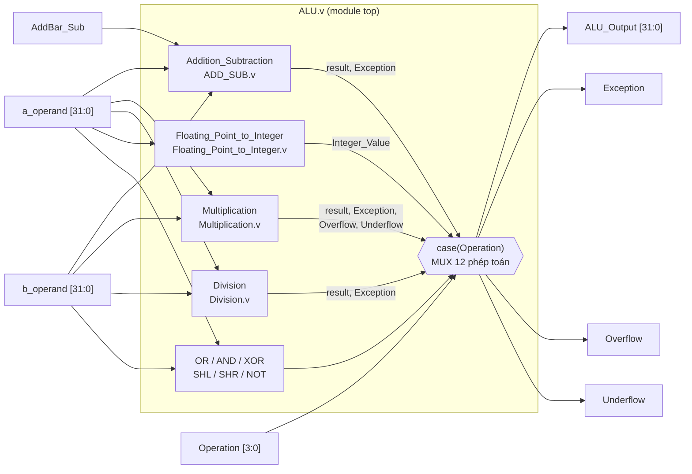
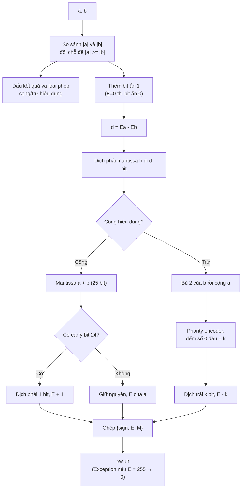
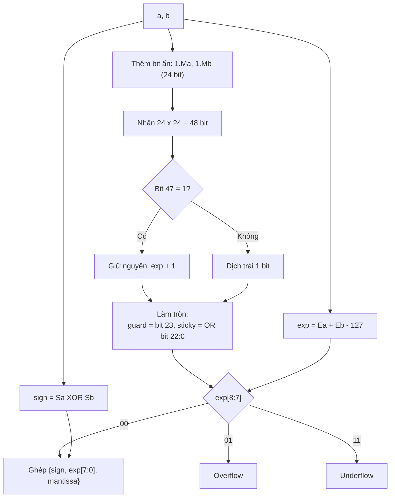
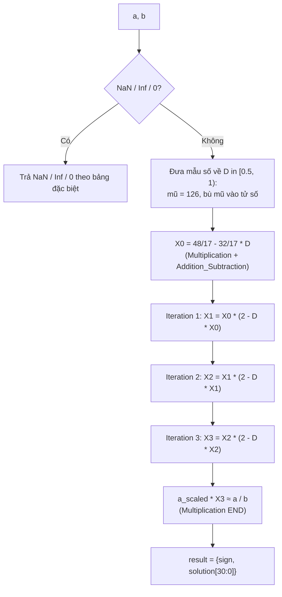
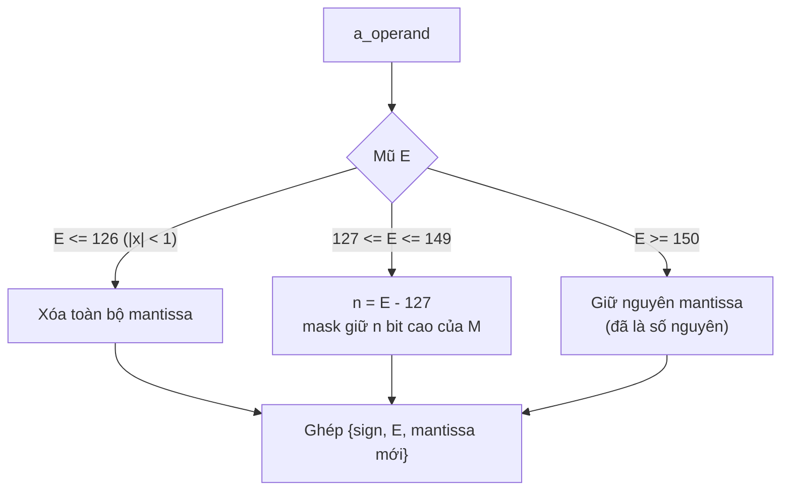

# 32-bit Floating Point ALU (IEEE 754) – Verilog

ALU số thực dấu phẩy động 32 bit (single precision) viết bằng Verilog, gồm cộng, trừ, nhân, chia (Newton-Raphson), chuyển float sang phần nguyên và các phép logic/dịch bit. Toàn bộ thiết kế là **mạch tổ hợp** (không có clock, reset hay FSM).

Phần lõi cộng/trừ/nhân/chia dựa trên *Design of 32 Bit Floating Point ALU Based on Standard IEEE-754 in Verilog* (S. S. Burada, Dayalbagh Educational Institute, 2019).

## 1. Định dạng IEEE 754 single precision

```
 31   30        23 22                      0
+---+------------+-------------------------+
| S |  E (8 bit) |       M (23 bit)        |
+---+------------+-------------------------+
x = (-1)^S * 1.M * 2^(E-127)      (1 <= E <= 254)
E = 0   : 0 / subnormal           E = 255 : Inf (M=0) / NaN (M!=0)
```

## 2. Sơ đồ khối tổng thể



### Bảng opcode

| Operation | Phép toán | Ghi chú |
| --- | --- | --- |
| 0 | Cộng/Trừ | `AddBar_Sub` = 0 cộng, = 1 trừ |
| 1 | Nhân | Có cờ Overflow/Underflow |
| 2 | Chia | Newton-Raphson |
| 3 | Trừ | Dùng chung mạch Addition_Subtraction |
| 4 / 5 / 6 | OR / AND / XOR | Bitwise trên 32 bit |
| 7 / 8 | Dịch trái / phải 1 bit | |
| 9 | Float → Integer (trunc) | Cắt phần lẻ, giữ định dạng float |
| 10 | Cộng | Dùng chung mạch Addition_Subtraction |
| 11 | NOT | |
| 12–15 | – | Ra 0 |

## 3. Phân cấp module


## 4. Đường đi dữ liệu từng thuật toán

### 4.1 Cộng / Trừ (`ADD_SUB.v`, `priority_encoder.v`)



### 4.2 Nhân (`Multiplication.v`)



### 4.3 Chia – Newton-Raphson (`Division.v`, `Iteration.v`)



Mỗi vòng `Iteration` gồm 2 phép nhân và 1 phép trừ float: `X(n+1) = X(n) * (2 - D * X(n))`. Sai số bình phương sau mỗi vòng (hội tụ bậc 2).

### 4.4 Float → Integer (`Floating_Point_to_Integer.v`)



## 5. Mô phỏng

- Công cụ: Icarus Verilog / ModelSim / Vivado Simulator.
- Testbench tự kiểm tra: `tb_ALU.v` (top = `tb_ALU`). Cuối mô phỏng in `TONG: N case, DUNG=…, SAI=…`.
- Script sinh testbench: `gentb.py` (kết quả chuẩn tính bằng float32 của Python, làm tròn về gần nhất).

## 6. Hạn chế đã biết

- Cộng/trừ cắt bỏ (không làm tròn), nên có thể lệch 1 ULP; chưa có bit guard/round/sticky.
- Chia bằng Newton-Raphson 3 vòng nên sai số còn 2–4 ULP; chưa có cờ Overflow/Underflow cho chia.
- Chưa hỗ trợ subnormal; Inf/NaN ở đầu vào của cộng/trừ/nhân cho kết quả 0.
- Opcode 9 chỉ cắt phần lẻ, vẫn ở dạng float.
